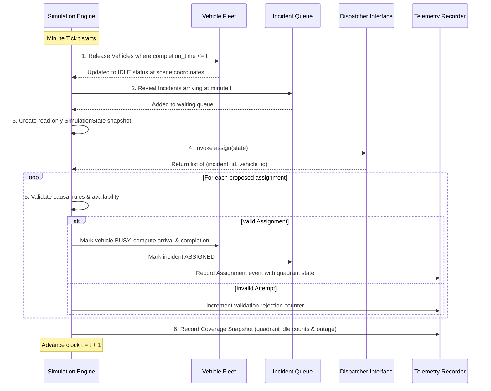
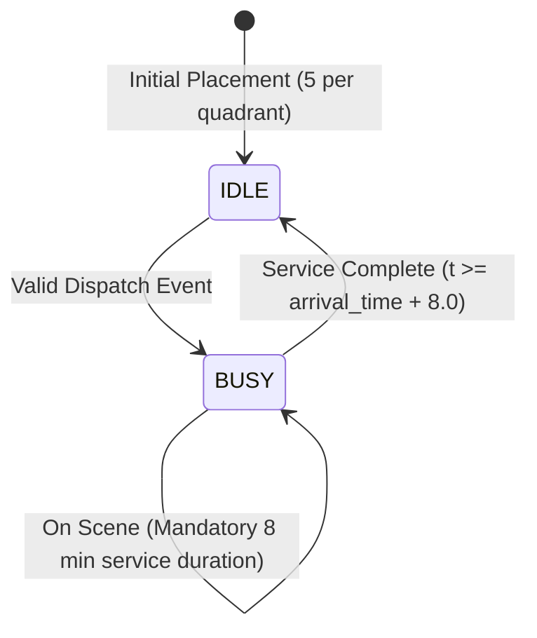
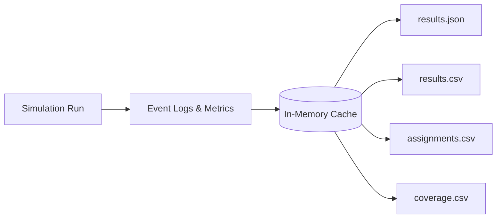

# Technical Design Document: Emergency Fleet Command System (AI-01)

## 1. System Architecture

The Emergency Fleet Command System is designed as a decoupled, multi-tier operational architecture with a deterministic simulation core, a high-performance REST API layer, and an interactive real-time operations dashboard.

```mermaid
graph TB
    subgraph Presentation_Tier["Presentation Tier (Browser)"]
        Dashboard["Operations Dashboard (React 18 + Vite)"]
        TacticalMap["Tactical 2D Canvas Map"]
        Timeline["Timeline Scrubber (0..120 min)"]
        Modals["Comparison & Export Modals"]
    end

    subgraph API_Tier["Application & API Tier (FastAPI)"]
        Router["API Router (/api/simulations)"]
        SecurityMW["Security & Size Middleware"]
        StaticServer["SPA Static File Server"]
        ExportSvc["Telemetry & CSV Exporter"]
    end

    subgraph Engine_Tier["Core Simulation & Dispatch Engine"]
        Engine["SimulationEngine"]
        Generator["ScenarioGenerator (PCG64)"]
        CausalBuffer["Causal Event Buffer"]
        Dispatcher["CoverageAwareDispatcher"]
        Baseline["GreedyBaselineDispatcher"]
        StateSnapshot["Immutable SimulationState"]
    end

    subgraph Storage_Tier["In-Memory Store"]
        MemStore["SimulationRunStore (LRU Cache)"]
        TelemetryRecords["Chronological Event Logs"]
    end

    Dashboard -->|POST /api/simulations| Router
    Dashboard -->|GET /api/simulations/{id}| Router
    Dashboard -->|GET /assets/*| StaticServer
    Router --> SecurityMW
    SecurityMW --> Engine
    Generator -->|Seed 20260911| Engine
    Engine --> CausalBuffer
    CausalBuffer -->|Time Filter t <= now| StateSnapshot
    StateSnapshot --> Dispatcher
    StateSnapshot -.-> Baseline
    Dispatcher -->|Dispatched Pairs| Engine
    Engine --> TelemetryRecords
    TelemetryRecords --> MemStore
    MemStore --> ExportSvc
    ExportSvc -->|JSON / CSV Stream| Router
```

---

## 2. Simulation Engine Design

### 2.1 Deterministic Tick Loop
The simulation models discrete time over a 120-minute operational window ($t \in [0, 120]$). The engine operates as a synchronous state machine with the following execution sequence per minute $t$:



### 2.2 Vehicle State Machine
Each vehicle $v \in \{V_1, \dots, V_{20}\}$ transitions across two operational states:



1. **Travel Duration**: With constant speed $s = 1.0\text{ unit/min}$, transit time equals distance:
   $$T_{\text{transit}} = \sqrt{(v_x - i_x)^2 + (v_y - i_y)^2}$$
2. **Arrival Time**: $T_{\text{arrival}} = t_{\text{dispatch}} + T_{\text{transit}}$.
3. **Completion Time**: $T_{\text{completion}} = T_{\text{arrival}} + 8.0$.
4. **Relocation Semantics**: Upon completion, the vehicle remains at $(i_x, i_y)$, shifting its quadrant coordinates to match the completed incident.

---

## 3. Causal Information Boundary

To strictly comply with the challenge rules, the system enforces structural isolation between future events and the decision agent:

1. **Information Horizon**: At minute $t$, the dispatcher only receives an immutable snapshot:
   ```python
   SimulationState(
       current_time=self.t,
       vehicles=[v.model_copy() for v in self.vehicles],
       revealed_incidents=[inc.model_copy() for inc in self.revealed_incidents],
       waiting_incidents=[inc.model_copy() for inc in waiting_incidents]
   )
   ```
2. **Quarantine of Future Incidents**: The master schedule `self.all_incidents` is stored in the engine's private scope and is **never** attached to `SimulationState`.
3. **Defensive Assignment Validation**: The engine inspects every tuple `(incident_id, vehicle_id)` returned by the dispatcher:
   - Rejects assignment if `incident.arrival_minute > self.t` (future incident access attempt).
   - Rejects assignment if `vehicle.status != IDLE` (busy vehicle).
   - Rejects assignment if `incident.status != WAITING` (already serviced).
   - Rejects duplicate assignments within the same tick.

---

## 4. Assignment Scoring & Dispatch Logic

The primary dispatcher, `CoverageAwareDispatcher`, formulates dispatching as a multi-criteria optimization problem over candidate pairs $(i, v)$ where $i \in \text{WaitingIncidents}$ and $v \in \text{IdleVehicles}$.

### 4.1 Priority Hierarchy
Incidents are ordered in the waiting queue by urgency:
$$\text{Priority } 3 \succ \text{Priority } 2 \succ \text{Priority } 1$$
Secondary sort is FIFO (arrival minute ascending), with deterministic tie-breaking on `incident.id`.

### 4.2 Objective Cost Formulation
For an incident $i$ with priority weight $W_p \in \{1, 3, 7\}$ and vehicle $v$:

$$C(i, v) = \text{ResponseCost}(i, v) + \frac{\text{CoveragePenalty}(v) + \text{ScarcityPenalty}(v)}{W_p}$$

#### Mathematical Components:
1. **Response Cost**:
   $$\text{ResponseCost}(i, v) = \sqrt{(v.x - i.x)^2 + (v.y - i.y)^2} \times 1.0$$
2. **Coverage Penalty**:
   $$\text{CoveragePenalty}(v) = \begin{cases} 100.0 & \text{if } \text{Idle}_{\text{after}}(Q_v) = 0 \\ 0.0 & \text{otherwise} \end{cases}$$
   Where $Q_v = \text{Quadrant}(v.x, v.y)$ and $\text{Idle}_{\text{after}}(Q_v) = \text{Idle}_{\text{before}}(Q_v) - 1$.
3. **Scarcity Penalty**:
   $$\text{ScarcityPenalty}(v) = \frac{20.0}{\max(1, \text{Idle}_{\text{before}}(Q_v))}$$

### 4.3 Deterministic Tie-Breaking
The selection candidate maximizes $\text{Score}(i, v) = -C(i, v)$. If $|\text{Score}_a - \text{Score}_b| \le 10^{-6}$:
1. **Distance**: Select $\arg\min \text{dist}(i, v)$.
2. **Lexicographical ID**: Select $\arg\min v.\text{id}$.

---

## 5. Coverage Preservation Mechanics

The operational grid is partitioned into four equal sectors of dimension $50 \times 50$:
- **Lower-Left (LL)**: $x \in [0, 50), y \in [0, 50)$
- **Upper-Left (UL)**: $x \in [0, 50), y \in [50, 100]$
- **Lower-Right (LR)**: $x \in [50, 100], y \in [0, 50)$
- **Upper-Right (UR)**: $x \in [50, 100], y \in [50, 100]$

### Dynamic Intra-Minute State Update
When multiple incidents are dispatched in the same minute tick $t$:
1. The dispatcher maintains a local quadrant tally initialized to the count of idle units in each quadrant.
2. Upon pairing $(i, v)$, the tally for $Q_v$ decrements immediately:
   $$\text{idle\_counts}[Q_v] \leftarrow \text{idle\_counts}[Q_v] - 1$$
3. The subsequent incident evaluation within the same tick immediately reflects the decreased availability, preventing simultaneous depletion.

---

## 6. Metric Calculations

All metrics are derived directly from logged simulation events and are completely decoupled from dispatcher heuristics:

| Metric Name | Formula / Definition | Operational Target |
| :--- | :--- | :--- |
| **Weighted Response Sum (WRS)** | $\sum_{a \in A} W(a) \times T_{\text{resp}}(a)$ | Minimize |
| **Weighted Response Mean (WRM)** | $\frac{\text{WRS}}{\|A\|}$ | Minimize |
| **P3 Mean Response Time** | $\frac{1}{\|A_{P3}\|} \sum_{a \in A_{P3}} T_{\text{resp}}(a)$ | Minimize |
| **P3 Median Response Time** | $\text{Median}(\{T_{\text{resp}}(a) \mid a \in A_{P3}\})$ | Minimize |
| **Total Outage Minutes** | $\sum_{t=0}^{120} \mathbf{1}\left(\exists q : \text{Idle}(q, t) = 0\right)$ | Minimize |
| **Sector Outage Minutes** | $\sum_{t=0}^{120} \mathbf{1}(\text{Idle}(q, t) = 0)$ for each $q \in \{\text{LL, UL, LR, UR}\}$ | Balance across sectors |
| **Invalid Dispatches** | Count of rejected assignment attempts | Strictly 0 |

---

## 7. Data Flow & Export Pipeline



- **`results.json`**: Complete simulation payload containing scenario metadata, vehicle trajectories, assignment logs, and computed metrics.
- **`results.csv`**: Header and row summary of all operational metrics matching evaluation standards.
- **`assignments.csv`**: Tabular dump of every assignment event containing origin coordinates, destination coordinates, dispatch time, arrival time, and quadrant counts.
- **`coverage.csv`**: Minute-by-minute quadrant vehicle tallies and boolean outage flags for all 120 minutes.

---

## 8. Error Handling & Defensive Architecture

1. **Input Boundary Enforcement**: Pydantic models validate all incoming requests. Numerical seeds and simulation lengths are constrained within safe ranges.
2. **Global Exception Handling**:
   - `StarletteHTTPException` preserves HTTP error codes (e.g. 404, 422).
   - Global unhandled exception catcher traps unexpected faults, logs tracebacks to secure server logs, and emits a sanitized `500 Internal Server Error` to the client.
3. **Path Traversal Protection**: Static asset handlers verify canonical paths to prevent CWE-22 attacks.
4. **Execution Performance Budget**: The engine utilizes high-speed model instantiation (`model_construct`) to guarantee simulation execution finishes in under 200ms.
